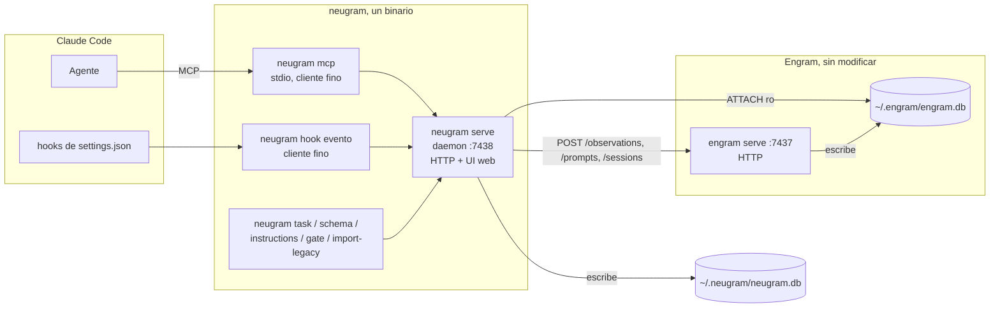
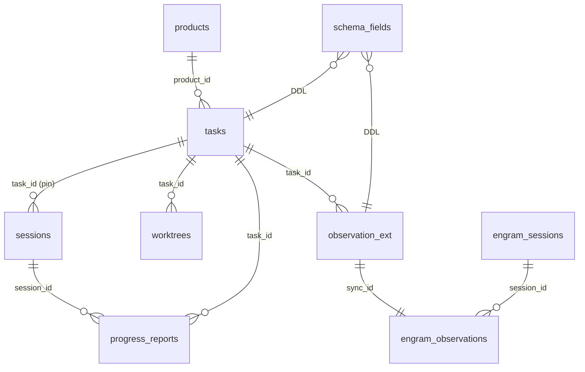
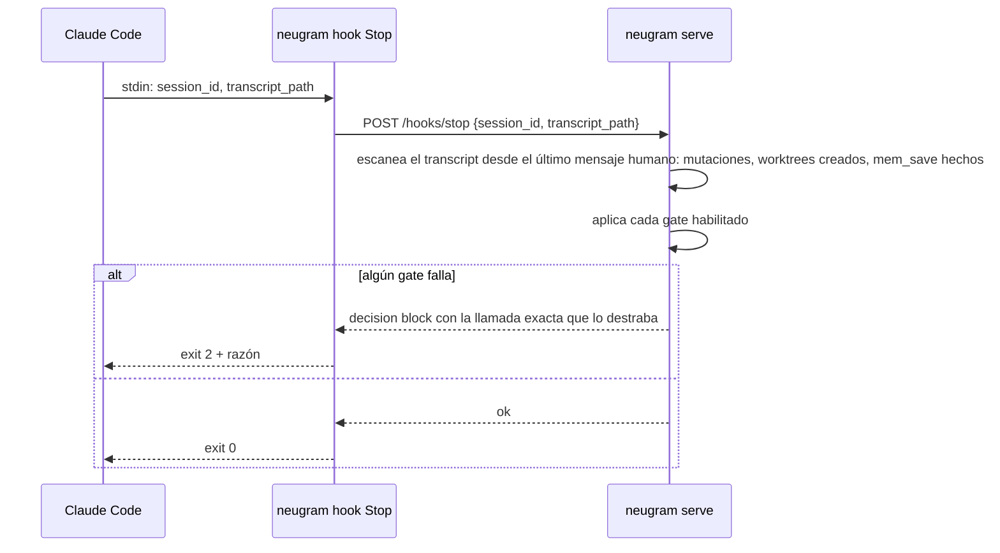

# Arquitectura

Un binario, tres roles en runtime, dos bases de datos: la propia y la de Engram
attacheada en solo lectura. Las decisiones detrás de cada pieza están en
`adr/`; los contratos exactos en `specs/`.

## Componentes



| Pieza | Responsabilidad | No hace |
|---|---|---|
| `serve` | Única conexión a `neugram.db`; ATTACH de `engram.db`; DDL idempotente desde `schema_fields`; HTTP propio; UI web; todas las llamadas al HTTP de Engram | No escribe en `engram.db` directamente, nunca |
| `mcp` | Traduce tools MCP a llamadas al HTTP propio; expone el JSON Schema generado | No abre la BD; no tiene lógica |
| `hook <evento>` | Lee el input del hook por stdin, llama al daemon, imprime el output que Claude espera; levanta el daemon si `:7438` no responde | No parsea transcripts por su cuenta más allá de lo que el daemon le pide |
| CLI de operación | Altas y cambios de tareas, productos, schema, instrucciones, gates; import | Corre contra el daemon, no contra la BD |

## Datos

Dos bases, un JOIN.



- Todo lo que un hook o el CLI consulta es columna en `neugram.db` (ADR 0002).
- Observaciones, prompts y sesiones de Engram siguen en `engram.db`. neugram las extiende 1:1 por `sync_id` en `observation_ext` (ADR 0003).
- Las columnas custom son DDL real sobre `tasks`, `observation_ext`, `worktrees` o `products`, generadas desde `schema_fields` (ADR 0004).

DDL completo: `specs/data-model.md`.

## Flujos

### Arranque de sesión

```mermaid
sequenceDiagram
    participant CC as Claude Code
    participant K as neugram hook SessionStart
    participant D as neugram serve
    participant E as Engram :7437
    CC->>K: stdin: session_id, cwd, source
    K->>D: ensure running; POST /hooks/session-start
    D->>E: POST /sessions {id, project, directory}
    D->>D: upsert sessions(id, cwd)
    D->>D: instrucciones = generadas(schema_fields) + libres(global | producto)
    D->>D: tareas abiertas; pin previo si la sesión ya existía; último handoff de la tarea pineada
    D-->>K: bloque markdown
    K-->>CC: stdout → contexto del agente
```

### Guardar una observación

```mermaid
sequenceDiagram
    participant A as Agente
    participant M as neugram mcp
    participant D as neugram serve
    participant E as Engram :7437
    A->>M: mem_save {title, content, type, task_id?, campos custom}
    M->>D: POST /observations
    D->>D: task_id = argumento o pin de la sesión; valida required de schema_fields
    D->>D: content += pie **Task**
    D->>E: POST /observations {session_id, type, title, content, project, scope, topic_key}
    E-->>D: {id}
    D->>D: SELECT sync_id FROM engram.observations WHERE id = ?
    D->>D: INSERT observation_ext(sync_id, task_id, kind, custom…)
    D-->>M: {id, sync_id, task_id}
    M-->>A: resultado
```

### Fin de turno (gates)



## Borde con Engram

Lo que la capa asume de Engram y cómo detectar que se rompió está en
`specs/engram-boundary.md`. Resumen:

- Rutas HTTP usadas: `POST /sessions`, `POST /sessions/{id}/end`, `POST /observations`, `PATCH /observations/{id}`, `POST /prompts`, `POST /conflicts/scan`, `POST /conflicts/judge`, `GET /health`.
- Tablas leídas por ATTACH: `observations` (columnas: `id`, `sync_id`, `session_id`, `type`, `title`, `content`, `project`, `scope`, `topic_key`, `created_at`, `updated_at`, `deleted_at`), `sessions`, `user_prompts`, y la tabla FTS de observaciones.
- `neugram doctor` verifica al arrancar que esas columnas existen y que `/health` responde. Si falta algo, el daemon arranca degradado y lo dice.

## Despliegue

Un usuario, una máquina. `go install` deja el binario; `~/.claude/settings.json`
apunta `mcpServers.neugram` a `neugram mcp` y los cinco eventos de hook a
`neugram hook <evento>`. El daemon se levanta solo con el primer hook o MCP y
queda residente. Sin systemd en la primera versión.

## Qué no es

No es un fork de Engram, no sincroniza, no tiene usuarios, no tiene motor de
reglas, y su MCP no permite cambiar schema ni instrucciones. `features.md`
lista el alcance completo y lo descartado.
