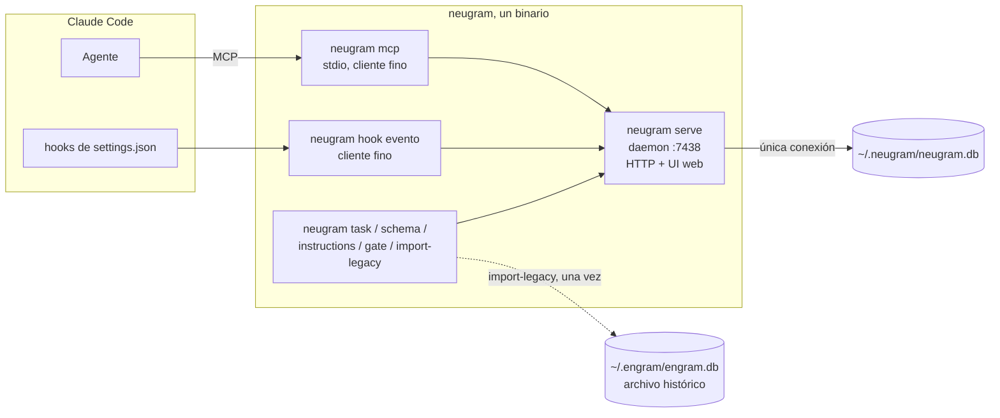
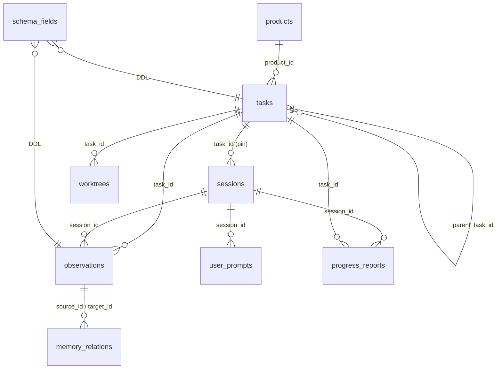
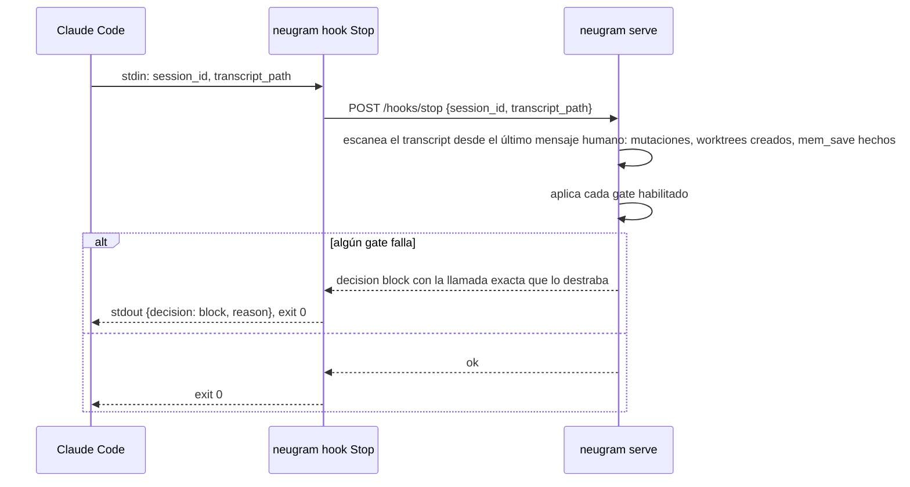

# Arquitectura

Un binario, tres roles en runtime, una base. Todo el código es propio: el
núcleo de memoria se escribe contra `specs/data-model.md`, no se copia de
Engram (ADR 0011). Las decisiones detrás de cada pieza están en `adr/`; los
contratos exactos en `specs/`.

## Componentes



| Pieza | Responsabilidad | No hace |
|---|---|---|
| `serve` | Única conexión a `neugram.db`; DDL idempotente desde `schema_fields`; observaciones, sesiones, prompts, FTS y conflictos; HTTP propio; UI web | No abre `~/.engram/engram.db`. Solo `import-legacy` lo hace, una vez |
| `mcp` | Traduce tools MCP a llamadas al HTTP propio; expone el JSON Schema generado | No abre la BD; no tiene lógica |
| `hook <evento>` | Lee el input del hook por stdin, llama al daemon, imprime el output que Claude espera; levanta el daemon si `:7438` no responde | No parsea transcripts por su cuenta más allá de lo que el daemon le pide |
| CLI de operación | Altas y cambios de tareas, productos, schema, instrucciones, gates; import | Corre contra el daemon, no contra la BD |

Un solo puerto, `:7438`, servido por `serve`. Ningún otro proceso participa;
el daemon de Engram se apaga en el corte (`specs/import-legacy.md`).

## Paquetes

```
cmd/neugram          subcomandos: serve, mcp, hook, task, product, schema,
                     instructions, gate, doctor, import-legacy
internal/store       la única conexión SQLite: DDL, CRUD, FTS, dedupe,
                     FindCandidates
internal/server      HTTP :7438 y UI web
internal/mcp         stdio, cliente fino del HTTP propio
internal/hooks       los cinco eventos y los gates
internal/cli         el CLI de operación
internal/project     repo: git remote → raíz git → basename
internal/timeutil    ISO 8601 UTC
```

No hay paquete heredado ni archivo con copyright ajeno: Engram se leyó como
referencia y se reimplementó. Qué entra por el import, qué se leyó y qué pasa
con la licencia MIT si algún día se copia un fragmento está en
`specs/engram-provenance.md`.

## Datos

Una base, sin JOIN entre schemas.



- Todo lo que un hook o el CLI consulta es columna (ADR 0002).
- `task_id` y `kind` son columnas de `observations`: no hay tabla de extensión ni clave de unión (ADR 0011).
- Las columnas custom son DDL real sobre `tasks`, `observations`, `worktrees` o `products`, generadas desde `schema_fields` (ADR 0004).
- `sync_id` es la clave pública de una observación; `id` existe porque FTS5 lo necesita como `content_rowid`.
- `tasks.parent_task_id` arma un árbol de tres niveles —épico, tarea, sub-tarea— con tope duro en triggers no recursivos (ADR 0012). La búsqueda sube a los ancestros por default y baja al subárbol sólo si se lo pide.

DDL completo: `specs/data-model.md`.

## Flujos

### Arranque de sesión

```mermaid
sequenceDiagram
    participant CC as Claude Code
    participant K as neugram hook SessionStart
    participant D as neugram serve
    CC->>K: stdin: session_id, cwd, source
    K->>D: ensure running; POST /hooks/session-start
    D->>D: upsert sessions(id, project, directory)
    D->>D: instrucciones = generadas(schema_fields) + libres(global | producto)
    D->>D: tareas abiertas; pin previo si la sesión ya existía; último handoff de la tarea pineada
    D-->>K: bloque markdown
    K-->>CC: stdout → contexto del agente
```

`project` sale de `internal/project`, que reimplementa la misma detección que
escribió los 6.805 registros importados: git remote → raíz git → basename del
directorio.

### Guardar una observación

```mermaid
sequenceDiagram
    participant A as Agente
    participant M as neugram mcp
    participant D as neugram serve
    A->>M: mem_save {title, content, type, task_id?, campos custom}
    M->>D: POST /observations
    D->>D: task_id = argumento o pin de la sesión; valida required de schema_fields
    D->>D: content += pie **Task**
    D->>D: INSERT observations (una transacción: fila, FTS por trigger, candidatos de conflicto)
    D-->>M: {sync_id, task_id, judgment_required, candidates}
    M-->>A: resultado
```

Una transacción, una base: el envelope de conflictos sale de `FindCandidates`
sobre las mismas filas que se acaban de escribir, sin un segundo servicio al
que preguntarle.

### Fin de turno (gates)



## Despliegue

Un usuario, una máquina. `make install` deja el binario; `~/.claude/settings.json`
apunta `mcpServers.neugram` a `neugram mcp` y los cinco eventos de hook a
`neugram hook <evento>`. El daemon se levanta solo con el primer hook o MCP y
queda residente; un cliente con otra versión lo reinicia, y si no responde los
hooks dejan pasar el turno (`specs/hooks.md`, Ciclo de vida del daemon). Sin
Docker ni systemd: la persistencia es el archivo `~/.neugram/neugram.db`.

## Qué no es

No sincroniza, no tiene usuarios, no tiene motor de reglas, y su MCP no permite
cambiar schema ni instrucciones. No es un fork ni una poda de upstream: no
comparte una línea de código con Engram, así que no hay nada que re-sincronizar
(`specs/engram-provenance.md`). `features.md` lista el alcance completo y lo
descartado.
